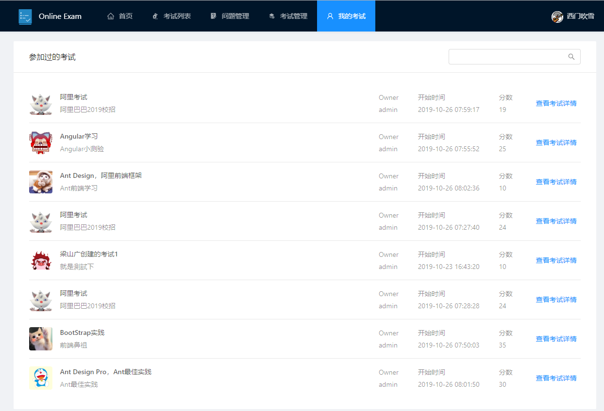

# spring-boot-online-exam 在线考试系统

> 在线 Demo：http://129.211.88.191，演示账号 `admin` / `teacher` / `student`，密码均为 `admin123`
>
> 视频讲解：https://www.bilibili.com/video/BV1FP4y1L7xt/
>
> 好消息：有小伙伴做了 Python 实现，欢迎 star：https://github.com/xingxingzaixian/django-drf-online-exam

基于 Spring Boot + Vue 3 的前后端分离在线考试系统：题库、组卷、考试、判分、学情统计在同一张工作台完成，同一套 Vue 3 界面在手机窄屏自动切换底部导航，无需另维护移动端工程。

## 目录

- [1. 功能一览](#1-功能一览)
- [2. 技术架构](#2-技术架构)
- [3. 目录结构](#3-目录结构)
- [4. 快速上手](#4-快速上手)
- [5. 使用说明（图文）](#5-使用说明图文)
- [6. 题目批量导入](#6-题目批量导入)
- [7. 接口文档与数据说明](#7-接口文档与数据说明)
- [8. 常见问题 FAQ](#8-常见问题-faq)
- [9. 参与贡献与路线图](#9-参与贡献与路线图)

## 1. 功能一览

### 1.1 三种角色能做什么

| 功能 | 学生 student | 教师 teacher | 管理员 admin |
| --- | :---: | :---: | :---: |
| 注册 / 登录（JWT） | ✅ | ✅ | ✅ |
| 学情概览（得分率、考试统计） | ✅（仅自己） | ✅（全部） | ✅（全部） |
| 考场：浏览考试、参加考试、自动判分 | ✅ | ✅ | ✅ |
| 我的答卷：查看每题对错与解析 | ✅ | ✅ | ✅ |
| 题库：单选 / 多选 / 判断，富文本题干与选项 | — | ✅ | ✅ |
| 题目 CSV / Excel 批量导入 | — | ✅ | ✅ |
| 试卷：组卷、编辑、软删除（不删题目） | — | ✅ | ✅ |
| 学情：全员成绩筛选、导出 CSV | — | ✅ | ✅ |
| 学科管理（有题目的学科不可删） | — | — | ✅ |
| 用户管理（新建、改角色、停用 / 启用） | — | — | ✅ |

补充规则（使用时容易踩坑，先记下来）：

- 题目是软删除（`visible=0`）。仍被未删除考试引用的题目**拒绝删除**；删除考试只隐藏场次，**不会删除题目**。
- 图片（考试封面、题目配图、富文本内图片）以 Base64 存入数据库，开箱即用，无需对象存储。
- 题干、选项、解析均支持富文本（WangEditor）。

### 1.2 题型说明

| 题型 | 答题方式 | 判分 |
| --- | --- | --- |
| 单选题 | 单选其一 | 选对即得该题分值 |
| 多选题 | 可多选 | 必须与答案完全一致才得分 |
| 判断题 | “正确 / 错误”二选一 | 选对即得该题分值 |

## 2. 技术架构

```text
浏览器 (Vue 3 SPA, 端口 5173 开发 / 9527 生产)
   │  REST / JSON, 请求头 Access-Token: <JWT>
   ▼
Spring Boot 4.1 (端口 9527, /api/*)
   │  Spring Data JPA (ddl-auto: update)
   ▼
MySQL 8 (库名 exam, 初始化脚本 doc/sql/exam.sql)
```

| 分层 | 技术 |
| --- | --- |
| 后端 | Java 21、Spring Boot 4.1、Spring Data JPA、springdoc OpenAPI、JWT（jjwt）、Spring Security Crypto（密码加密）、Commons CSV + POI（题目导入） |
| 前端 | Vue 3、Vite、Vue Router、Pinia、Element Plus、WangEditor（富文本）、ECharts（概览页得分率分布） |
| 部署 | Dockerfile 多阶段构建（前端 dist 打进 Spring Boot 静态资源，一个 `app.jar` 对外服务）+ `docker-compose.yml`（MySQL 8.4 + app，一键启动） |

关键端口与地址：

| 场景 | 地址 |
| --- | --- |
| 一键部署后访问 | http://localhost:9527 |
| 前端本地开发 | http://localhost:5173（接口代理到 9527，见 `frontend/vite.config.js`） |
| 后端接口 | http://localhost:9527/api |
| 接口文档 Swagger UI | http://localhost:9527/swagger-ui.html |

## 3. 目录结构

```text
.
├── backend/                 # Spring Boot 后端
│   ├── pom.xml              # Java 21, Spring Boot 4.1
│   └── src/main/
│       ├── java/lsgwr/exam/
│       │   ├── web/ApiController.java      # /api/* 全部接口
│       │   ├── service/ExamPlatformService.java  # 业务逻辑
│       │   ├── entity/                     # User / Question / Exam / ExamRecord …
│       │   ├── repo/                       # Spring Data JPA
│       │   ├── security/                   # JWT 签发与校验、密码加密
│       │   └── config/                     # 拦截器、异常处理、SPA 回退
│       └── resources/application.yml
├── frontend/                # Vue 3 前端
│   ├── vite.config.js
│   └── src/
│       ├── router.js        # 路由与角色守卫（staff / admin）
│       ├── api.js           # axios 封装（Access-Token 请求头）
│       ├── layouts/Shell.vue  # 侧边栏 + 移动端底部导航
│       └── views/           # Login / Register / Dashboard / Hall / TakeExam …
├── doc/
│   ├── sql/exam.sql         # 数据库初始化脚本
│   └── images/              # 本说明引用的截图
├── Dockerfile               # 前端构建 → 后端打包 → JRE 运行
└── docker-compose.yml       # mysql + app 一键编排
```

## 4. 快速上手

### 4.1 方式一：容器一键启动（推荐）

前置条件：Docker + Docker Compose。

```shell
docker compose up --build
```

- 浏览器打开 http://localhost:9527。
- MySQL 会用 `doc/sql/exam.sql` 自动初始化，演示数据和账号开箱即有。
- 登录账号：`admin` / `teacher` / `student`，密码都是 `admin123`。

常用环境变量（`docker-compose.yml` 已给出默认值，按需覆盖）：

| 变量 | 默认值 | 说明 |
| --- | --- | --- |
| `DB_HOST` / `DB_PORT` / `DB_NAME` | `mysql` / `3306` / `exam` | 后端连接的 MySQL 地址 |
| `DB_USER` / `DB_PASSWORD` | `root` / `aA111111` | 需与 MySQL 容器的 `MYSQL_ROOT_PASSWORD` 一致 |
| `JWT_SECRET` | 内置默认值 | 生产环境请务必换成自己的长随机串 |

### 4.2 方式二：本地开发（前后端分离调试）

前置条件：JDK 21、Node 20+、MySQL 8。

1. 新建 `exam` 库并导入数据：

   ```shell
   mysql -uroot -p -e "CREATE DATABASE IF NOT EXISTS exam CHARACTER SET utf8mb4;"
   mysql -uroot -p exam < doc/sql/exam.sql
   ```

2. 确认数据库密码与 `backend/src/main/resources/application.yml`（或环境变量 `DB_PASSWORD` 等）一致，默认连 `localhost:3306/exam`，用户名 `root`、密码 `aA111111`。

3. 启动后端：

   ```shell
   cd backend
   mvn spring-boot:run
   ```

4. 另开一个终端启动前端：

   ```shell
   cd frontend
   npm install
   npm run dev
   ```

5. 打开 http://localhost:5173 登录（接口已代理到 9527，无需额外配置跨域）。

## 5. 使用说明（图文）

> 本节截图来自 `doc/images/`，对应历史上线版本界面；当前代码已升级为 Vue 3 + Element Plus 全新视觉，但**操作流程与按钮位置保持一致**，可对照使用。

### 5.1 注册与登录

- 打开首页，未登录会自动跳到 `/login`。演示环境可直接用 `admin / teacher / student`（密码 `admin123`）体验三种角色。
- 没有账号点“没有账号，去注册”，新账号默认是**学生**；教师和管理员由管理员在“用户”页分配。

登录后左侧（桌面端）是导航：概览、考场、我的答卷人人可见；题库、试卷、学情需要教师及以上；学科、用户仅管理员可见。手机窄屏时导航自动收到底部。

### 5.2 学生路径：参加考试 → 查看答卷

#### 步骤 1：在“考场”挑选考试

进入左侧导航「考场」（路由 `/hall`），每场考试是一张卡片：封面、简介、总分、限时，以及单选 / 多选 / 判断各几题一目了然。点「开始作答」进入答题页。


> 要点：考场列表（`GET /api/exams`）所有登录用户可见；教师组卷后学生端实时出现，无需重新登录。

#### 步骤 2：在倒计时内作答并交卷

答题页（路由 `/exam/:id`）顶部有倒计时（`timeLimit` 分钟），归零自动交卷。单选 / 判断点选其一，多选可勾多个；题目配图和富文本格式原样呈现。


> 要点：
>
> - 交卷前会二次确认；超时系统自动提交当前答案。
> - 提交后立即自动判分并跳转到答卷详情，无需等待教师批改（当前均为客观题）。

#### 步骤 3：在“我的答卷”复盘每一题

交卷后跳转到答卷详情（路由 `/records/:id`），也可随时从「我的答卷」列表点进每一场：总分、用时一目了然，每题展示你的答案、正确答案与解析。




### 5.3 教师路径：建题 → 组卷 → 看学情

#### 步骤 1：在“题库”新建题目

进入「题库」（路由 `/questions`，教师及以上可见），点「新建题目」：题干和解析用富文本编辑器，可插图；选好题型（单选 / 多选 / 判断）、难度、学科和分值后，在选项区点选正确答案。判断题可用“一键填入正确 / 错误”快捷按钮。


> 要点：
>
> - 单选 / 判断用圆点单选指定正确答案；多选每个选项独立勾选，可多个正确。
> - 配图点“上传配图”，以 Base64 存库，前端直接渲染。

#### 步骤 2：编辑或删除题目

在题目行点「编辑」，弹窗回填题干、选项与答案，改完保存即生效；点「删除」是软删除，被未删除考试引用的题目会**被拒绝删除**，先去「试卷」把引用去掉再删。


#### 步骤 3：在“试卷”组卷

进入「试卷」（路由 `/papers`），点「新建考试」：填名称、简介、上传封面，设时长与三类题型每题分值，再从题库按题型多选题目，保存即发布到学生端「考场」。已发布的考试同样可以点「编辑」增删题目、调分值；点「删除」只隐藏场次，题目仍在题库。


> 组卷公式：总分 = 单选题数 × 单选分值 + 多选题数 × 多选分值 + 判断题数 × 判断分值，保存后列表直接显示总分。

#### 步骤 4：在“学情”看成绩与导出

进入「学情」（路由 `/grades`，教师及以上可见）：顶部是答卷数、平均分、最高分、及格率，可按考试筛选全员成绩，点“答卷”穿透到某学生的逐题详情；点「导出 CSV」下载成绩表。

### 5.4 管理员路径：学科与用户

管理员拥有教师全部权限，外加两块：

- 「学科」（路由 `/subjects`，仅管理员）：新建学科供题库选用；仍有题目的学科不可删除，先把题目移到其他学科或删除题目。
- 「用户」（路由 `/users`，仅管理员）：新建用户并指定 管理员 / 教师 / 学生；可改昵称邮箱、重置密码、切换角色；「停用」后该账号无法登录，需要时再「启用」。

### 5.5 概览页：每天先看这张图

登录后默认进入「概览」（路由 `/dashboard`）：学生看到自己的考试数、题目数、答卷数与平均分；教师 / 管理员额外看到全站得分率分布饼图、各场考试人次 / 均分 / 最高 / 最低 / 及格率，以及各学科学题量。

## 6. 题目批量导入

教师在「题库」点「批量导入」，先点「下载模板」拿到 CSV 表头，按模板填好后上传，系统会逐行校验并报告“成功 N 题、失败 M 行 + 原因”。

CSV 模板（与前端 `Questions.vue` 内置模板一致）：

```csv
type,level,category,score,stem,optionA,optionB,optionC,optionD,answer
single,易,数学,5,1+1等于几,1,2,3,4,B
judge,易,生活,5,地球是圆的,,,,,正确
```

字段说明：

| 字段 | 写法 |
| --- | --- |
| `type` | `single` 单选 / `multiple` 多选 / `judge` 判断 |
| `level` | 难度名称，需与学科基础数据一致（如 易 / 中 / 难） |
| `category` | 学科名称，需先在「学科」页建好 |
| `score` | 每题分值，正整数 |
| `stem` | 题干文本 |
| `optionA~D` | 选项文本（判断题可留空） |
| `answer` | 单选填 `A/B/C/D`；多选填如 `AB`；判断填 `正确` / `错误` |

同时支持 `.xlsx` 文件，接口为 `POST /api/questions/import`（multipart `file`）。

## 7. 接口文档与数据说明

- 本地启动后端后打开 http://localhost:9527/swagger-ui.html 查看全部 `/api/*` 接口（springdoc 自动生成）。
- 认证方式：登录 `POST /api/auth/login` 拿 `token`，之后每个请求带请求头 `Access-Token: <token>`（前端 `src/api.js` 已封装，401 自动踢回登录页）。
- 核心接口速查：`GET /api/exams` 考场列表、`GET /api/exams/{id}/paper` 拿卷、`POST /api/exams/{id}/submit` 交卷、`GET /api/records(/:id)` 我的答卷、`/api/questions` 题库增删改查、`POST /api/questions/import` 批量导入、`POST /api/media` 图片转 Base64、`GET /api/grades(/export)` 成绩与导出、`GET /api/analytics` 概览统计、`GET/POST/PUT/DELETE /api/subjects` 学科、`/api/users` 用户。
- 数据库：`doc/sql/exam.sql` 为最新初始化脚本（含演示账号与样题）；`doc/sql/exam_bak_*.sql` 为历史备份，日常使用忽略即可。

## 8. 常见问题 FAQ

1. **前后端端口是什么？** 生产一体化部署只看 9527；本地开发前端 5173、后端 9527，Vite 已把 `/api` 代理到 9527。
2. **登录 401 / 被踢回登录页？** token 过期或密码被重置，重新登录即可；确认请求头带的是 `Access-Token` 而不是 `Authorization`。
3. **题目删不掉？** 被未删除考试引用时会拒绝删除，这是保护机制：先去「试卷」编辑该考试、移除这道题，再删题。
4. **考试删了题目还在？** 符合预期：删除考试只隐藏场次，题目仍留在题库，可组到别的考试。
5. **学科删不掉？** 该学科下还有题目时拒绝删除，先迁移或删除题目。
6. **本地后端连不上库？** 检查 `DB_HOST/DB_PORT/DB_NAME/DB_USER/DB_PASSWORD` 与 MySQL 是否一致，默认 `localhost:3306/exam`、`root/aA111111`；Docker 启动则用服务名 `mysql`。
7. **图片存在哪？** 存数据库 Base64 字段，无需配 OSS；注意单文件上限 8MB（见 `application.yml`）。
8. **移动端要另装 App 吗？** 不用，同一套页面在窄屏自动切换底部导航。

## 9. 参与贡献与路线图

1. Fork 本仓库。
2. 新建 `exam_xxx` 分支。
3. 提交代码。
4. 新建 Pull Request。

已完成：

- [x] 修复题目创建失败等 issue bug
- [x] 考试详情编辑
- [x] 题目和考试软删除（`visible=0`，引用保护；删考试不删题）
- [x] 图片 Base64 入库（封面、配图、富文本内图片）
- [x] 题干和选项富文本
- [x] CSV / Excel 模板批量导入题目
- [x] 用户管理、学科管理
- [x] 教师查看全部考生成绩和每场考试统计
- [x] 概览页得分率、学科题量和考试统计
- [x] Dockerfile 与 docker compose 一键部署
- [x] 移动端：同一套 Vue 3 界面窄屏底部导航，不另维护 uni-app 工程

## License

本项目采用 [LICENSE](LICENSE) 许可。
