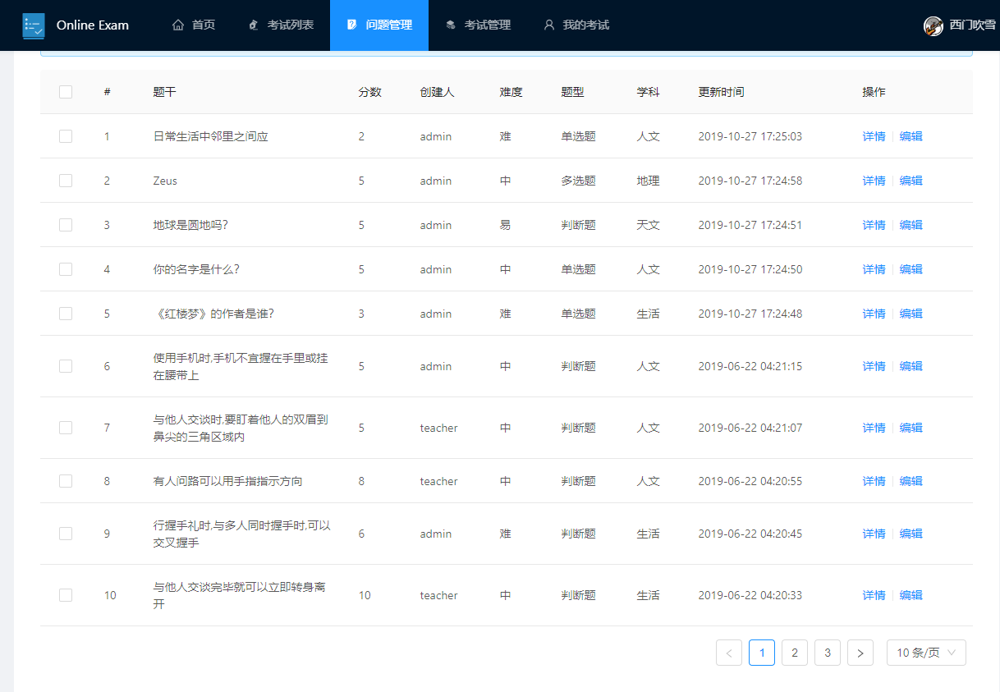
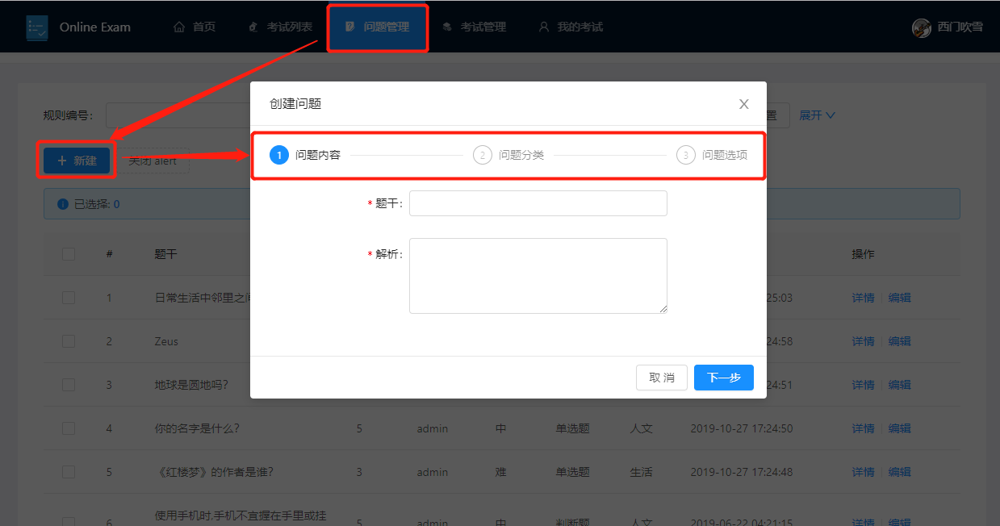
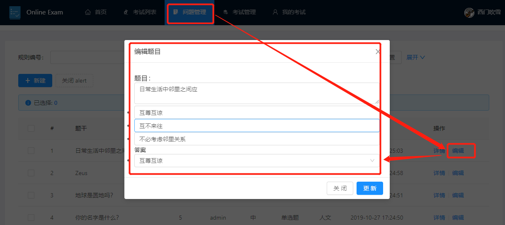
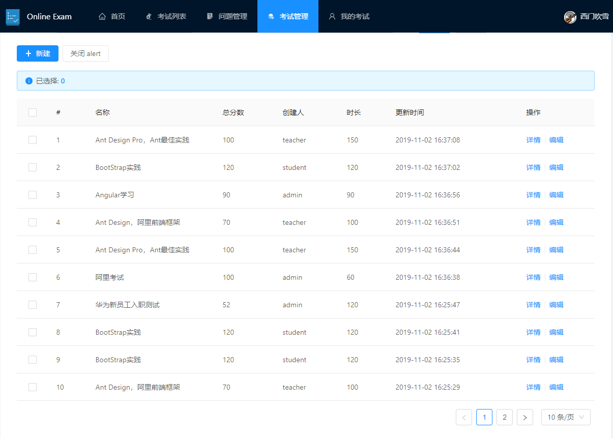
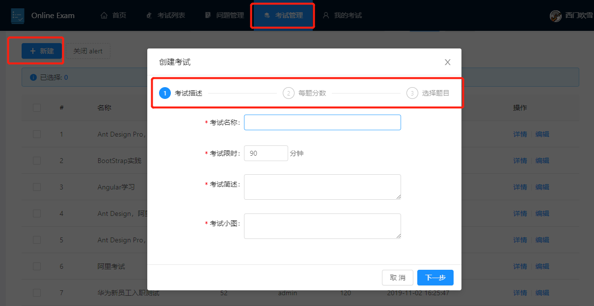
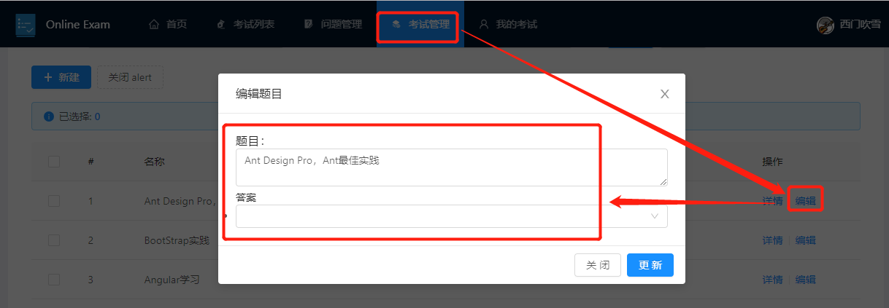
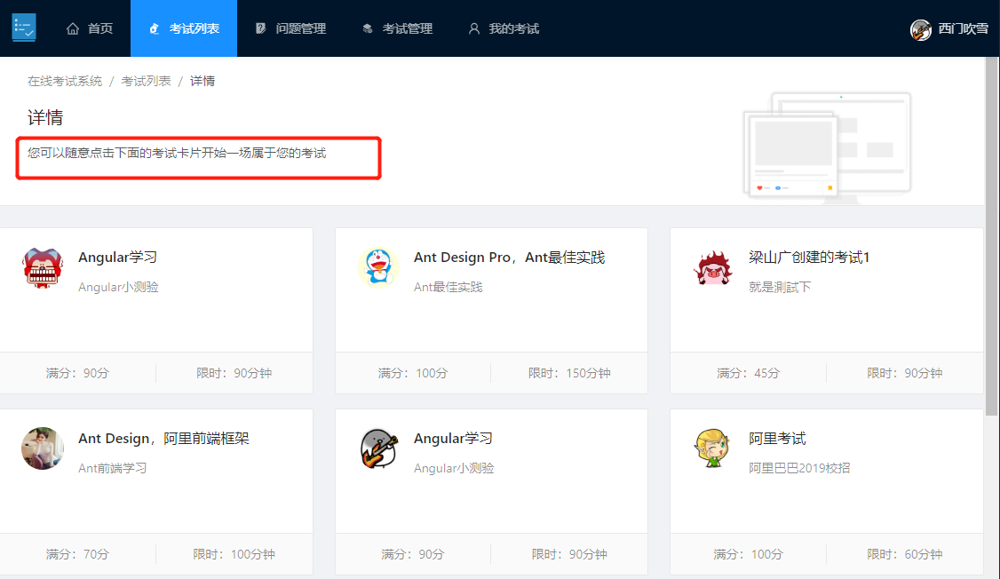
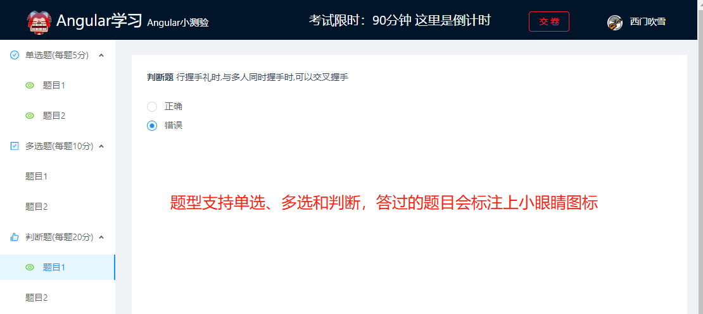
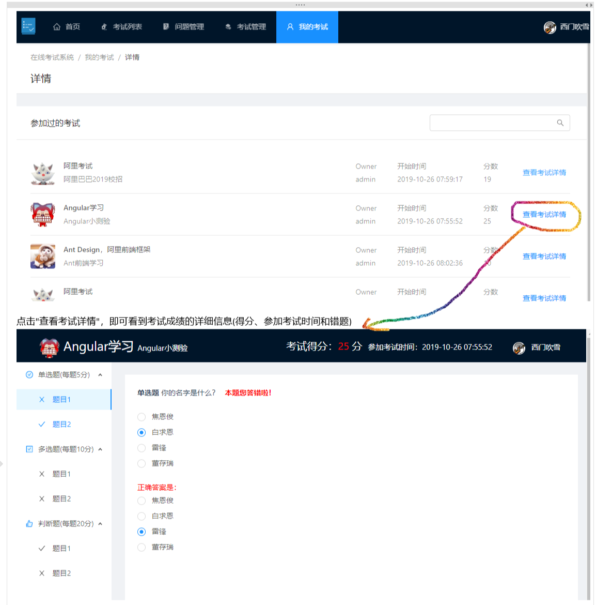

# spring-boot-online-exam

> 在线Demo预览，http://129.211.88.191 ，账户分别是admin、teacher、student，密码是admin123。视频讲解代码：https://www.bilibili.com/video/BV1FP4y1L7xt/

> 好消息！！！一个小伙伴做了Python实现，欢迎大家star：https://github.com/xingxingzaixian/django-drf-online-exam

当前技术栈：Java 21、Spring Boot 4.1、Vue 3、Vite、Element Plus。演示账号仍是 `admin` / `teacher` / `student`，密码 `admin123`。

## 1.快速体验
### 1.1 容器一键启动

```shell
docker compose up --build
```

浏览器打开 http://localhost:9527 。MySQL 会用 `doc/sql/exam.sql` 初始化。

### 1.2 本地开发

准备 JDK 21、Node 20+ 和 MySQL 8，导入 `doc/sql/exam.sql` 到 `exam` 库，密码与 `backend/src/main/resources/application.yml` 一致。

```shell
cd backend && mvn spring-boot:run
cd frontend && npm install && npm run dev
```

前端开发地址 http://localhost:5173 ，接口代理到 9527。

## 2.介绍
基于springboot的在线考试系统

### 2.1 功能简介

+ 支持单选题、多选题、判断题
+ 支持学生(student)、教师(teacher)、管理员(admin)三种角色
  + 学生：参加考试和查看我的考试
  + 教师：学生的所有权限+创建/编辑题目+创建/编辑考试
  + 管理员：教师的所有权限+管理用户

### 2.3 软件架构

> 前后端分离，前段组件化，方便二次开发；后端

+ 后端：Spring Boot 4.1 + Spring Data JPA + springdoc OpenAPI + JWT
+ 前端：Vue 3 + Vite + Pinia + Element Plus + WangEditor，布局按手机宽度自适应

### 2.3 使用教程

+ 1.下载代码
  ```shell
  git clone https://github.com/19920625lsg/spring-boot-online-exam.git
  ```
+ 2.初始化数据库
  > 安装mysql的步骤这里省略，网上的教程很多。安装好mysql后，新建exam数据库，密码和`spring-boot-online-exam/backend/exam/src/main/resources/application.yml`的`password: xxxxxx`保持一致，然后导入`spring-boot-online-exam/doc/sql/exam.sql`
+ 3.启动后端
  > 打开`spring-boot-online-exam/backend/exam`这个Maven项目，可以在IDE里启动或者执行`mvn install`生成jar包启动
+ 4.启动前端
  + 进入到前端代码路径 `cd spring-boot-online-exam/frontend/exam/`
  + 安装依赖 `npm install`
  + 启动前端 `npm run serve`
+ 5.部署完毕，查看效果
  > 打开 http://localhost:8000 或者 http://本机ip:8000 即可查看演示效果

## 3.功能图示

+ 1.管理题目
  + 1.1 题目列表
    > 
  + 1.2 题目创建
    > 
  + 1.3 题目更新
    > 
+ 2.考试管理
  + 2.1 考试列表
    > 
  + 2.2 考试创建
    > 
  + 2.3 考试更新(`还有点小bug，开发中`)
    > 
+ 3.我的考试
  + 3.1 参加考试
    > 在"考试列表"模块点击自己想参加的考试卡片即可
    > 
    > 
  + 3.2 考试记录查看
    > 

## 4.参与贡献

1.  Fork 本仓库
2.  新建 exam_xxx 分支
3.  提交代码
4.  新建 Pull Request

## 5.Todo
+ `√`0.修复issue提地bug：题目创建失败
+ `√`1.考试详情编辑
+ `√`2.题目和考试软删除：`visible=0`。题目仍被未删除考试引用时拒绝删除；删除考试不删除题目
+ `√`3.图片以 Base64 存入数据库（封面、配图、富文本内图片）
+ `√`4.题干和选项支持富文本
+ `√`5.按 CSV / Excel 模板批量导入题目
+ `√`6.用户管理、学科管理
+ `√`7.教师查看全部考生成绩和每场考试统计
+ `√`8.概览页得分率、学科题量和考试统计
+ `√`9.Dockerfile 与 docker compose 一键部署
+ `√`10.移动端：同一套 Vue 3 界面在窄屏使用底部导航，不另维护 uni-app 工程
