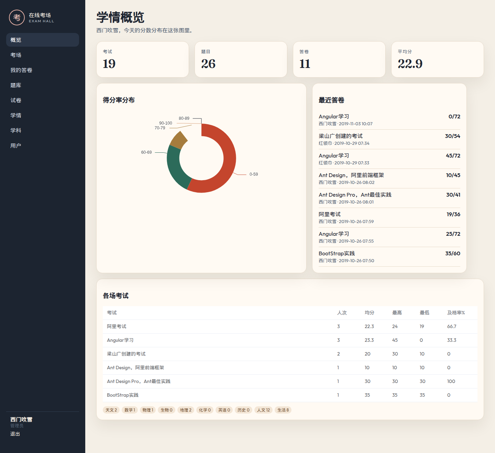
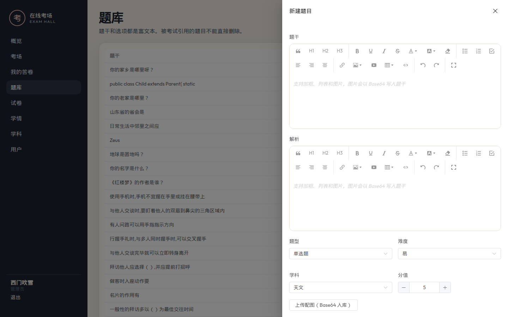
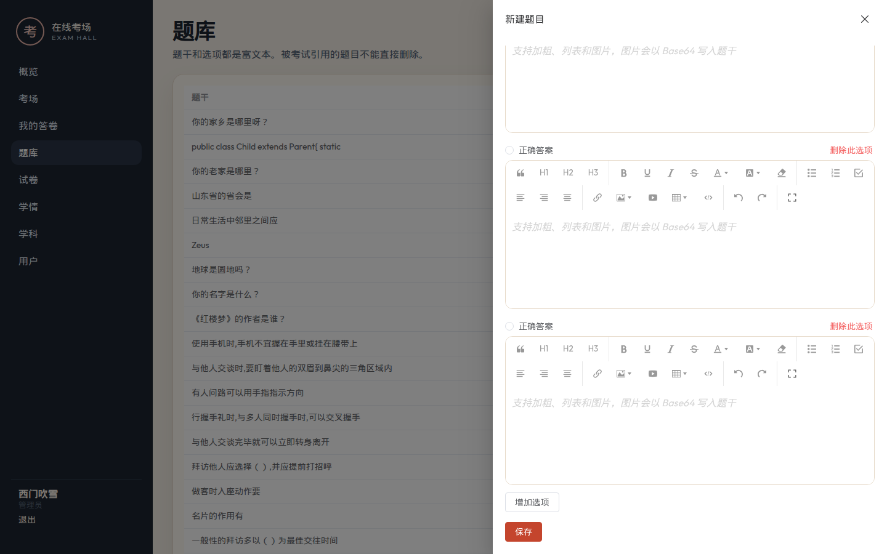
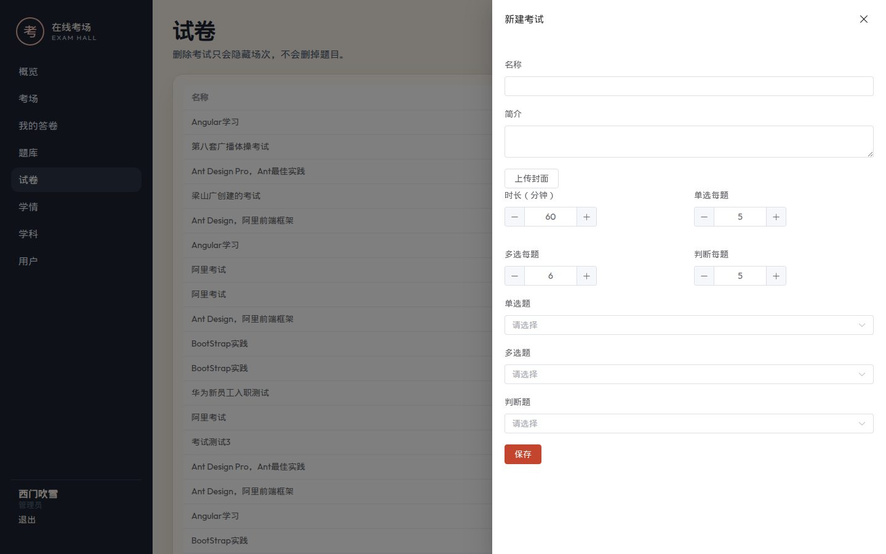

# spring-boot-online-exam

在线考试系统。教师维护题库和试卷，学生在考场作答，管理员管理学科和用户。

在线 Demo：http://129.211.88.191  
演示账号 `admin`、`teacher`、`student`，密码都是 `admin123`。  
代码讲解：https://www.bilibili.com/video/BV1FP4y1L7xt/  
Python 实现：https://github.com/xingxingzaixian/django-drf-online-exam

当前技术栈：Java 21、Spring Boot 4.1、Vue 3、Vite、Element Plus。

## 1. 启动

### 1.1 容器一键启动

```shell
docker compose up --build
```

浏览器打开 http://localhost:9527 。MySQL 会用 `doc/sql/exam.sql` 初始化。

### 1.2 本地开发

准备 JDK 21、Node 20+ 和 MySQL 8。新建 `exam` 库，密码与 `backend/src/main/resources/application.yml` 里的 `password` 一致（默认 `aA111111`），然后导入 `doc/sql/exam.sql`。

```shell
cd backend && mvn spring-boot:run
cd frontend && npm install && npm run dev
```

前端开发地址 http://localhost:5173 ，接口代理到 9527。接口文档在 http://localhost:9527/swagger-ui.html 。

## 2. 三种角色

| 角色 | 账号 | 能做的事 |
| --- | --- | --- |
| 学生 | `student` | 看概览、进考场作答、查看自己的答卷 |
| 教师 | `teacher` | 学生的全部能力，再加上题库、组卷、学情 |
| 管理员 | `admin` | 教师的全部能力，再加上学科和用户 |

新注册的账号是学生。教师和管理员由管理员在「用户」里分配。窄屏会收起侧栏，改用顶部栏和底部导航，学生端只保留「概览 / 考场 / 我的答卷」。

## 3. 使用说明

### 3.1 登录和注册

打开登录页，输入用户名和密码，点「进入考场」。页面上写着三个演示账号。没有账号时，从「去注册」进入注册页，填写用户名、密码、昵称和邮箱。


### 3.2 看概览

登录后进入「概览」。管理员和教师看到学情概览：考试数、题目数、答卷数、平均分、得分率分布、最近答卷，以及每场考试的人次、均分和及格率。学生看到的是「我的考场」，统计只包含自己的答卷。



### 3.3 参加考试

学生、教师和管理员都可以从「考场」进入。每张卡片有封面、名称、简介、总分、时长，以及单选、多选、判断的题量。点「开始作答」。


作答页顶部是倒计时。单选和判断点一个选项，多选可以点多个。做完后点「交卷」，确认后进入成绩详情。时间走完会自动交卷。


「我的答卷」列出自己交过的卷，包含得分、用时和交卷时间。点「查看」进入逐题结果：绿色是答对的选项，红色是答错或漏选。


手机上同一套页面改用底部导航。学生只能在概览、考场和我的答卷之间切换。


### 3.4 维护题库

教师和管理员打开「题库」。列表里是题干、题型、学科和难度。点「编辑」修改，「删除」会把题目隐藏；题目仍被未删除的考试引用时，不能删除。


点「新建题目」。题干、解析和选项都是富文本，可以加粗、插列表，图片会以 Base64 写入数据库。选择题型、难度、学科和分值，再上传配图。单选和判断用单选标记「正确答案」；多选则给每个正确选项打勾。判断题可以点「填入判断题正确 / 错误」。最后点「保存」。





批量导入：先点「下载模板」，按表头填 CSV 或 Excel，再点「批量导入」。

| 列 | 含义 |
| --- | --- |
| type | `single` / `多选` / `判断`，也接受 `multi`、`judge` |
| level | `易`、`中`、`难` |
| category | 已存在的学科名称，例如 `数学` |
| score | 分值 |
| stem | 题干 |
| optionA 到 optionD | 选项，判断题可以留空 |
| answer | 单选填 `B`，多选填 `A,C`，判断填 `正确` 或 `错误` |

模板里的两行示例：

```text
type,level,category,score,stem,optionA,optionB,optionC,optionD,answer
single,易,数学,5,1+1等于几,1,2,3,4,B
judge,易,生活,5,地球是圆的,,,,,正确
```

### 3.5 组卷

打开「试卷」，点「新建考试」。填写名称、简介，上传封面，设置时长，以及单选、多选、判断各自的每题分值。从下拉框里按题型选题，至少选一题，再点「保存」。总分由题量和每题分值相加得到。

编辑已有考试时点「编辑」。点「删除」只会隐藏这场考试，题目仍留在题库。




### 3.6 看学情

「学情」给教师和管理员看全部考生成绩。上方是答卷数、平均分、最高分和及格率。用下拉框按考试筛选，点「导出 CSV」下载成绩。点某一行的「答卷」可以打开那份答卷详情。


### 3.7 管理学科和用户

这两项只有管理员能看见。

「学科」以卡片列出名称、简介和题目数量。点「新建学科」填写名称和简介。仍有题目的学科不能删除。


「用户」列出用户名、昵称、角色、邮箱和状态。点「新建用户」填写资料，并把角色设成管理员、教师或学生。点「停用」后该账号无法登录。修改密码时填写新密码，保存后会用新的加密方式入库。


## 4. 软件架构

前后端分离。后端提供 REST 接口，前端用组件页面按角色显示菜单。

- 后端：Spring Boot 4.1、Spring Data JPA、springdoc OpenAPI、JWT
- 前端：Vue 3、Vite、Pinia、Element Plus、WangEditor
- 图片：封面、配图和富文本里的图片以 Base64 存在数据库中

## 5. 参与贡献

1. Fork 本仓库
2. 新建 `exam_xxx` 分支
3. 提交代码
4. 新建 Pull Request

## 6. 已完成

- 修复题目创建失败
- 考试详情可以编辑
- 题目和考试软删除：`visible=0`。题目仍被未删除考试引用时拒绝删除；删除考试不删除题目
- 图片以 Base64 存入数据库
- 题干和选项支持富文本
- 按 CSV / Excel 模板批量导入题目
- 用户管理、学科管理
- 教师查看全部考生成绩和每场考试统计
- 概览页得分率、学科题量和考试统计
- Dockerfile 与 docker compose 一键部署
- 移动端：同一套 Vue 3 界面在窄屏使用底部导航
