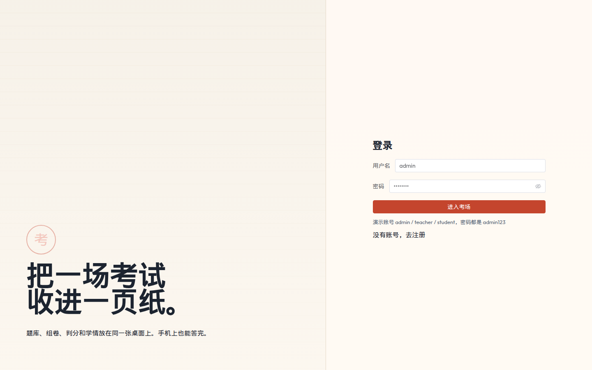
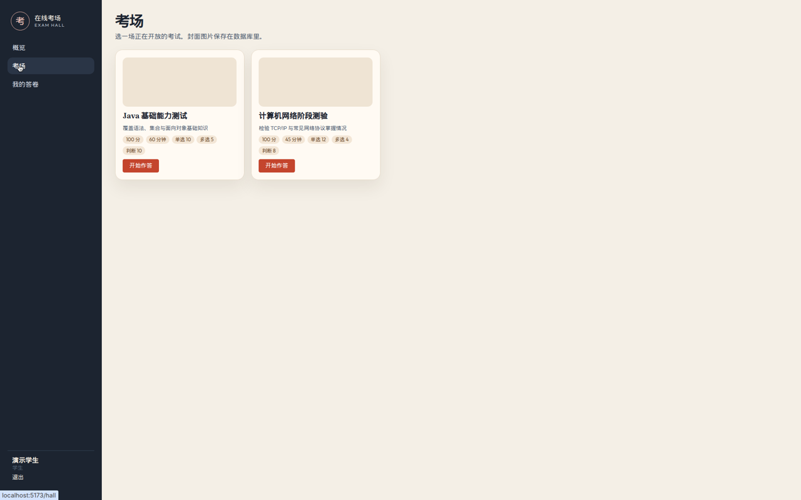
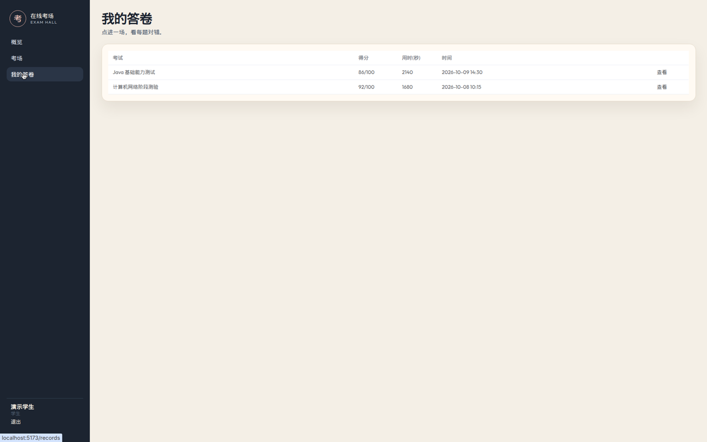
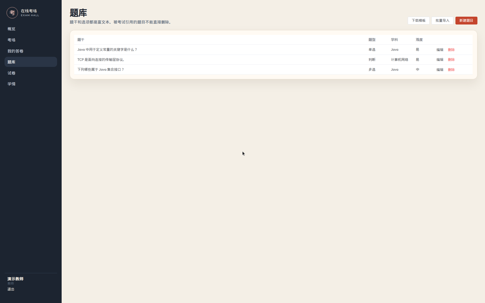
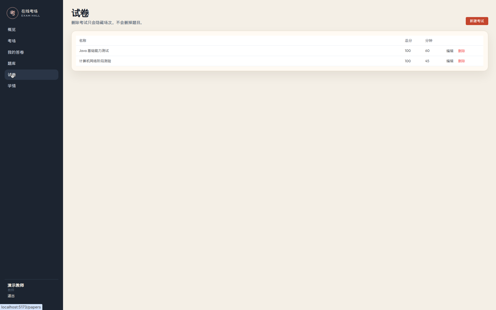
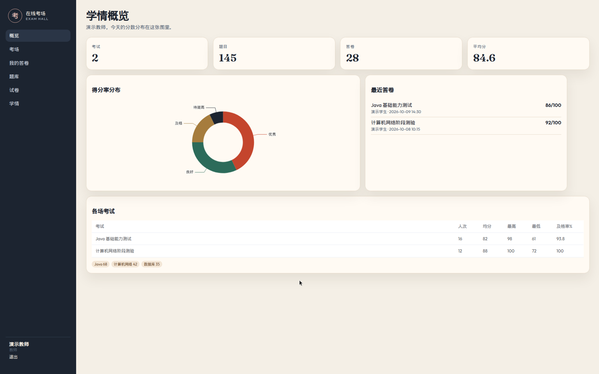
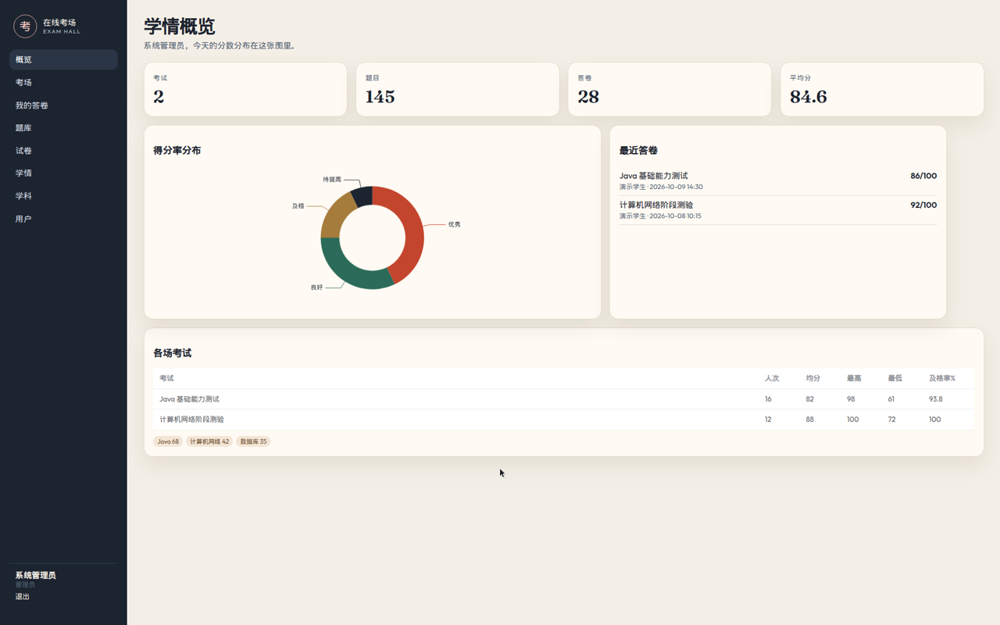
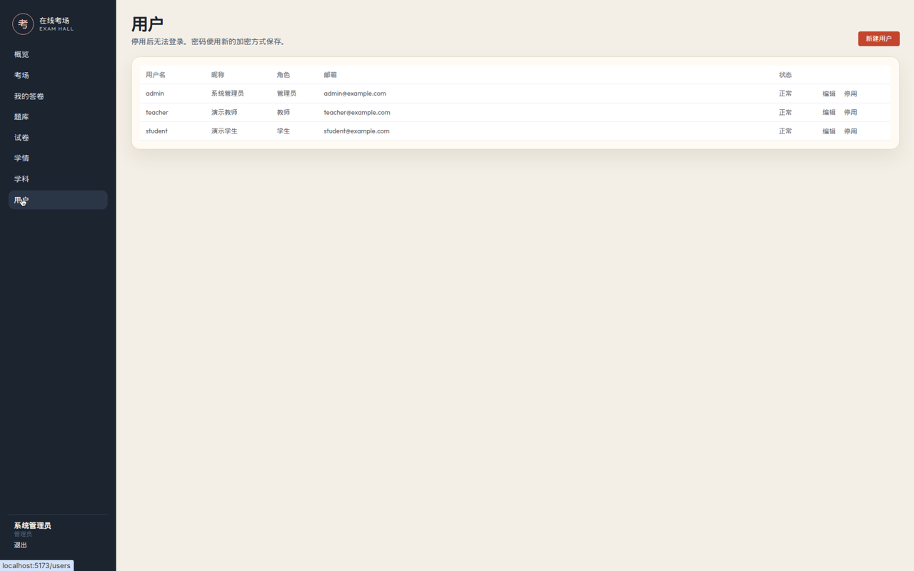
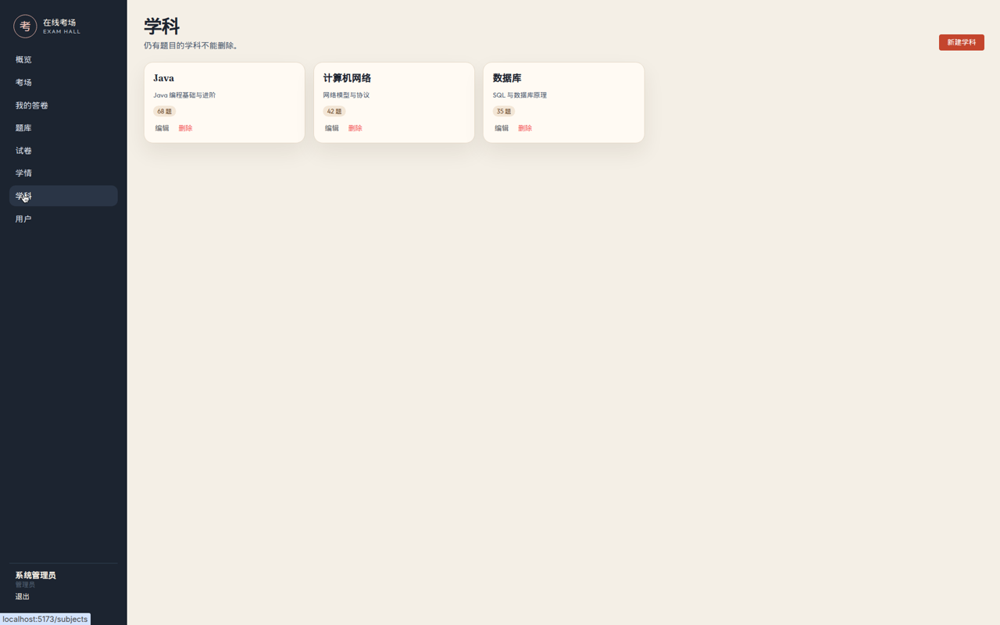

# 在线考试系统用户指南

本文按角色介绍当前界面的主要操作。所有用户登录后都可以使用“概览”“考场”和“我的答卷”；教师和管理员还会看到与权限对应的管理菜单。

- [学生操作指南](#student-guide)
- [教师操作指南](#teacher-guide)
- [管理员操作指南](#admin-guide)
- [常见问题](#faq)

## 学生操作指南

### 1. 登录

1. 打开系统地址，在“用户名”和“密码”输入框中填写账号信息。
2. 单击“进入考场”。登录成功后会进入“概览”页；账号或密码错误时，页面会提示登录失败。

演示学生账号为 `student`，密码为 `admin123`。

### 2. 进入考场并打开考试

1. 单击导航菜单“考场”，进入当前开放考试的卡片列表。
2. 在目标考试卡片上核对总分、时长和题型数量。
3. 单击“开始作答”，进入该场考试的答题页；页面会显示题目、分值和剩余时间。

### 3. 作答并交卷

1. 按题选择答案；多选题可以选择多个选项。
2. 完成后单击页面底部“交卷”，再在“确认交卷？”对话框中确认。
3. 系统提交并自动判分，随后进入本次答卷详情页。倒计时归零时系统也会自动交卷。

### 4. 查看我的答卷

1. 单击导航菜单“我的答卷”，进入自己的历史答卷列表，可查看考试、得分、用时和提交时间。
2. 单击某行右侧的“查看”，进入答卷详情页，查看每题对错、自己的作答和正确答案。

## 教师操作指南

教师继承学生的全部权限，还可以使用“题库”“试卷”和“学情”。教师不能管理用户或学科，因此导航中不会显示“用户”和“学科”。

### 1. 新建或批量导入题目

1. 单击“题库”，进入题目列表。
2. 新建单题时，单击“新建题目”，在抽屉中填写题干、解析、题型、难度、学科、分值和选项，标记正确答案后单击“保存”。抽屉关闭并返回更新后的题目列表。
3. 批量导入时，先单击“下载模板”获取 CSV 示例并按模板填写；再单击“批量导入”选择 `.csv` 或 `.xlsx` 文件。导入结束后会显示成功与失败数量，并刷新题目列表。
4. 列表中的“编辑”和“删除”用于维护已有题目。正在被考试引用的题目不能直接删除。

### 2. 创建试卷

1. 单击“试卷”，进入考试列表，再单击“新建考试”。
2. 在抽屉中填写名称、简介、时长和各题型分值，可上传封面，并分别选择单选题、多选题和判断题。
3. 单击“保存”，抽屉关闭并返回更新后的试卷列表；新考试也会出现在学生的“考场”中。
4. 可通过列表中的“编辑”修改试卷，或用“删除”隐藏考试。隐藏考试不会删除题库中的题目。

### 3. 查看班级成绩

1. 单击“学情”，进入全部考生的成绩页。页面顶部显示答卷数、平均分、最高分和及格率。
2. 在“全部考试”下拉框中选择一场考试，列表和统计会更新为该考试的数据。
3. 单击成绩行右侧的“答卷”可进入该考生的答卷详情；单击“导出 CSV”可下载当前筛选范围的成绩。

## 管理员操作指南

管理员可以访问全部模块：学生的“概览”“考场”“我的答卷”，教师的“题库”“试卷”“学情”，以及管理员专属的“学科”和“用户”。

### 1. 管理用户

1. 单击“用户”，进入用户列表，可查看用户名、昵称、角色、邮箱和状态。
2. 单击“新建用户”，填写用户名、密码、昵称、邮箱并选择角色，单击“保存”后返回更新后的列表。
3. 单击已有用户的“编辑”可修改资料、角色或重置密码；单击“停用”会阻止该账号登录，“启用”可恢复登录。

### 2. 管理学科

1. 单击“学科”，进入学科卡片列表，可查看每个学科的简介和题目数量。
2. 单击“新建学科”，填写名称和简介，再单击“保存”返回更新后的列表。
3. 使用卡片上的“编辑”或“删除”维护学科。仍有题目的学科不能删除，应先处理关联题目。

## 常见问题

### 为什么看不到某些菜单？

菜单按登录角色显示。学生只看到“概览”“考场”“我的答卷”；教师额外看到“题库”“试卷”“学情”；管理员再额外看到“学科”“用户”。无权限用户即使直接访问受限地址，也会被带回“概览”。如角色刚被管理员修改，请退出后重新登录以刷新会话信息。

### 数据库如何初始化？

使用 Docker Compose 时，MySQL 仅在首次创建空的 `exam-db` 数据卷时自动执行 `doc/sql/exam.sql`。本地开发时，需要先创建 `exam` 数据库，再手动导入该 SQL 文件，具体命令见[根 README](../README.md#本地开发)。

### 系统使用哪些端口？

- Docker Compose 对外提供应用端口 `9527`，访问 <http://localhost:9527>；容器中的 MySQL 不映射到主机端口。
- 本地开发时，Vite 前端使用 `5173`，Spring Boot 后端使用 `9527`，前端将 `/api` 代理到后端。
- 本地 MySQL 通常使用 `3306`，也可通过后端的 `DB_PORT` 环境变量调整。

### Docker 数据会一直保留吗？

数据库保存在名为 `exam-db` 的 Docker 数据卷中，执行 `docker compose down`、重启容器或再次构建应用都不会删除它，初始化 SQL 也不会重复执行。只有确认不再需要现有数据时，才运行 `docker compose down -v` 删除容器和数据卷；下次启动会重新初始化演示数据。
